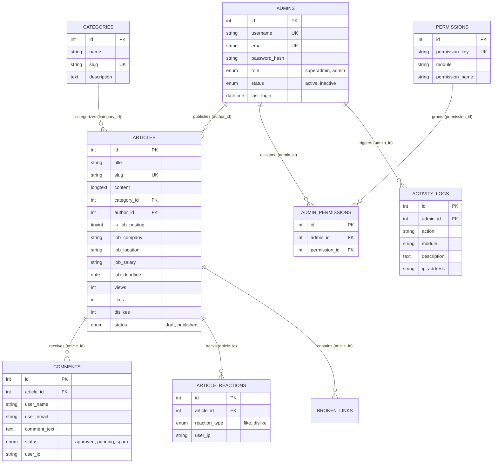
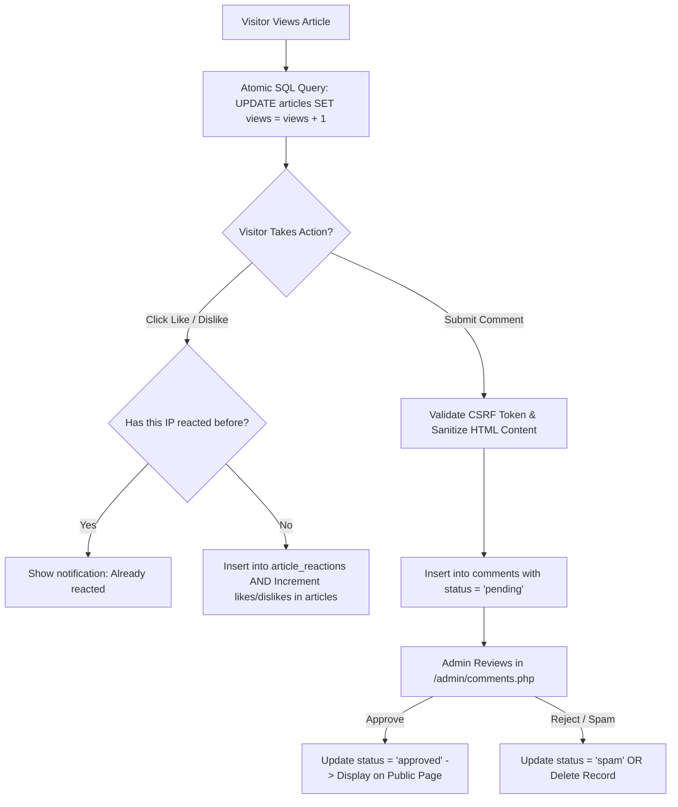
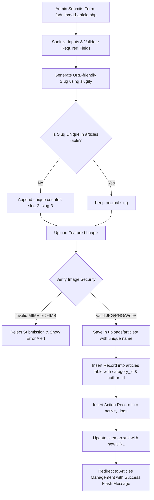

# 📊 CareerNexaa - Database Architecture & Data Overview Guide
## Mukammal Data Model, Tables, Relationships aur Flowcharts ki Tafseeli Guide (Roman Urdu & English)

---

## 📌 1. Data Model Overview (Data Ka Kholasa)

CareerNexaa Job Portal ka database **MySQL / MariaDB** (InnoDB Engine) par mushtamil hai. Database ka naam **`job_portal_db`** hai aur isme kul **14 tables** hain.

### 🌟 Key Data Highlights:
- **Character Set**: `utf8mb4` with `utf8mb4_unicode_ci` (Full international character support aur emojis).
- **Referential Integrity**: Relational foreign keys aur `ON DELETE CASCADE` rules taake data clean rahe aur orphan records na banain.
- **Security & Privacy**: Passwords Bcrypt hash me store hote hain, IP addresses rate limiting aur reaction tracking ke liye use hote hain, sensitive sessions database se alag rehte hain.
- **Auditability**: Admin panel ke har create, update, delete aur login action ka audit log `activity_logs` table me record hota hai.

---

## 🗺️ 2. Entity Relationship Diagram (ERD)

Yeh diagram tamam 14 tables ke aapas ke relations ko visualize karta hai:



---

## 🗃️ 3. Tamam 14 Tables ki Tafseeli Wazahat (Table-by-Table Breakdown)

---

### 1️⃣ Table: `articles` (Markazi Content Table - 40 Columns)
Website ka sara content (Jobs + Career Blog Guides) is table me store hota hai.

| Column Name | Data Type | Nullable | Key | Tafseel |
|---|---|---|---|---|
| `id` | `INT` | NO | `PRI` | Har article ka unique ID (Auto Increment) |
| `title` | `VARCHAR(255)` | NO | - | Mukammal Headline / Title |
| `slug` | `VARCHAR(255)` | NO | `UNI` | Clean URL slug (e.g., `remote-react-developer-job`) |
| `excerpt` | `TEXT` | NO | - | Mukhtasir samri (Cards aur search results ke liye) |
| `content` | `LONGTEXT` | NO | - | Full sanitized HTML content |
| `featured_image` | `VARCHAR(255)` | YES | - | Uploaded cover image ka relative path |
| `category_id` | `INT` | NO | `MUL` | FK: `categories.id` (Kis category me hai) |
| `author_id` | `INT` | NO | `MUL` | FK: `admins.id` (Kis admin ne likha) |
| `status` | `ENUM('draft', 'published')` | YES | `MUL` | Publication status (Draft ya Published) |
| `is_job_posting` | `TINYINT(1)` | YES | - | `1` = Genuine Job Circular, `0` = Career Blog Guide |
| `job_company` | `VARCHAR(150)` | YES | - | Hiring company ka naam |
| `job_location` | `VARCHAR(150)` | YES | - | Job ki location (e.g. Remote, Lahore, Dubai) |
| `job_type` | `VARCHAR(50)` | YES | - | Full-time, Part-time, Contract, Internship |
| `job_salary` | `VARCHAR(100)` | YES | - | Salary package (e.g. $70,000 - $90,000/yr) |
| `job_deadline` | `DATE` | YES | - | Apply karne ki aakhri tareekh |
| `views` | `INT` | YES | - | Total visit counter (Har page load par +1) |
| `likes` | `INT` | NO | - | Total positive reactions count |
| `dislikes` | `INT` | NO | - | Total negative reactions count |
| `seo_title` | `VARCHAR(255)` | YES | - | Custom Google `<title>` tag |
| `meta_description` | `VARCHAR(300)` | YES | - | Google search meta snippet |
| `keywords` | `VARCHAR(500)` | YES | - | Comma-separated SEO tags (Hashtags ban kar aate hain) |
| `video_type` | `VARCHAR(50)` | YES | - | `none`, `youtube`, `vimeo` |
| `video_url` | `VARCHAR(500)` | YES | - | Embedded video ka URL |
| `is_featured` | `TINYINT(1)` | YES | - | Featured badge aur homepage top highlight |
| `is_trending` | `TINYINT(1)` | YES | - | Trending sidebar tag |
| `is_recommended` | `TINYINT(1)` | YES | - | Recommended reads box me show karna |
| `is_trash` | `TINYINT(1)` | YES | - | Soft-delete flag (Trash bin me move karna) |
| `published_at` | `TIMESTAMP` | YES | `MUL` | Live publish hone ki tareekh aur waqt |
| `created_at` | `TIMESTAMP` | NO | - | Record create hone ka waqt |
| `updated_at` | `TIMESTAMP` | NO | - | Record last edit hone ka waqt |

---

### 2️⃣ Table: `categories` (Job Sectors & Career Topics)
Jobs aur blog posts ko categorize karne ke liye.

| Column Name | Data Type | Nullable | Key | Tafseel |
|---|---|---|---|---|
| `id` | `INT` | NO | `PRI` | Category ID |
| `name` | `VARCHAR(100)` | NO | - | Name (e.g., Remote Jobs, Software Engineering, Interview Tips) |
| `slug` | `VARCHAR(100)` | NO | `UNI` | URL slug (e.g., `remote-jobs`) |
| `description` | `TEXT` | YES | - | Category ki mukhtasir tafseel |
| `created_at` | `TIMESTAMP` | NO | - | Creation timestamp |

---

### 3️⃣ Table: `admins` (Administrative User Accounts)
Admin panel me access rakhne wale users.

| Column Name | Data Type | Nullable | Key | Tafseel |
|---|---|---|---|---|
| `id` | `INT` | NO | `PRI` | Admin User ID |
| `name` | `VARCHAR(100)` | NO | - | Mukammal naam (e.g., Faizan) |
| `username` | `VARCHAR(50)` | NO | `UNI` | Unique login username |
| `email` | `VARCHAR(100)` | NO | `UNI` | Contact / login email address |
| `password_hash` | `VARCHAR(255)` | NO | - | Bcrypt encrypted password |
| `role` | `ENUM('superadmin', 'admin')` | NO | - | Super Admin (full power) ya Staff Admin |
| `status` | `ENUM('active', 'inactive')` | NO | - | Account active hai ya suspend |
| `last_login` | `DATETIME` | YES | - | Aakhri dafa login hone ka timestamp |
| `reset_token` | `VARCHAR(100)` | YES | - | 6-digit OTP code forgot password ke liye |
| `reset_token_expires`| `DATETIME` | YES | - | OTP code expire hone ka waqt (1 hour) |
| `created_at` | `TIMESTAMP` | NO | - | Account creation date |
| `updated_at` | `TIMESTAMP` | NO | - | Last profile update date |

---

### 4️⃣ Table: `permissions` (System Granular Capability Keys)
System ke 29 alag modules aur actions ke access tokens.

| Column Name | Data Type | Nullable | Key | Tafseel |
|---|---|---|---|---|
| `id` | `INT` | NO | `PRI` | Permission ID |
| `permission_key` | `VARCHAR(60)` | NO | `UNI` | Code me check hone wali key (e.g., `jobs.create`, `posts.delete`) |
| `permission_name`| `VARCHAR(100)` | NO | - | Label (e.g. Create Job Postings) |
| `module` | `VARCHAR(50)` | NO | - | Group: `jobs`, `posts`, `categories`, `media`, `users`, `logs` |
| `description` | `VARCHAR(255)` | YES | - | Explaination ke yeh permission kya allow karti hai |
| `created_at` | `TIMESTAMP` | NO | - | Timestamp |

---

### 5️⃣ Table: `admin_permissions` (Staff Role Assignment Matrix)
Staff Admin aur Permissions ke darmian Many-to-Many junction table.

| Column Name | Data Type | Nullable | Key | Tafseel |
|---|---|---|---|---|
| `id` | `INT` | NO | `PRI` | Record ID |
| `admin_id` | `INT` | NO | `MUL` | FK: `admins.id` (ON DELETE CASCADE) |
| `permission_id` | `INT` | NO | `MUL` | FK: `permissions.id` (ON DELETE CASCADE) |
| `created_at` | `TIMESTAMP` | NO | - | Permission assign hone ka waqt |

---

### 6️⃣ Table: `comments` (Public Visitor Feedback & Moderation)
Articles par readers ke comments.

| Column Name | Data Type | Nullable | Key | Tafseel |
|---|---|---|---|---|
| `id` | `INT` | NO | `PRI` | Comment ID |
| `article_id` | `INT` | NO | `MUL` | FK: `articles.id` (ON DELETE CASCADE) |
| `user_name` | `VARCHAR(100)` | NO | - | Comment karne wale ka naam |
| `user_email` | `VARCHAR(150)` | NO | - | Email address |
| `comment_text` | `TEXT` | NO | - | Comment message (sanitized) |
| `status` | `ENUM('approved', 'pending', 'spam')`| NO | `MUL` | Default `pending` hota hai jab tak admin approve na kare |
| `user_ip` | `VARCHAR(45)` | NO | - | Visitor ka IP address (spam detection ke liye) |
| `user_agent` | `VARCHAR(255)` | YES | - | Browser aur OS details |
| `created_at` | `TIMESTAMP` | NO | `MUL` | Comment submit hone ka waqt |
| `updated_at` | `TIMESTAMP` | NO | - | Status update ka waqt |

---

### 7️⃣ Table: `article_reactions` (IP-Based Likes & Dislikes)
Duplicate votes se bachane ke liye unique IP checks ke sath reactions.

| Column Name | Data Type | Nullable | Key | Tafseel |
|---|---|---|---|---|
| `id` | `INT` | NO | `PRI` | Reaction ID |
| `article_id` | `INT` | NO | `MUL` | FK: `articles.id` (ON DELETE CASCADE) |
| `reaction_type` | `ENUM('like', 'dislike')` | NO | - | Type: Like ya Dislike |
| `user_ip` | `VARCHAR(45)` | NO | - | Unique voter IP (ek IP ek article par ek vote) |
| `user_agent` | `VARCHAR(255)` | YES | - | Voter ka browser info |
| `created_at` | `TIMESTAMP` | NO | - | Timestamp |

---

### 8️⃣ Table: `activity_logs` (Security & Audit Trail)
Admin panel ke har critical action ka chronological record.

| Column Name | Data Type | Nullable | Key | Tafseel |
|---|---|---|---|---|
| `id` | `INT` | NO | `PRI` | Log ID |
| `admin_id` | `INT` | YES | `MUL` | Action perform karne wale admin ka ID |
| `admin_name` | `VARCHAR(100)` | YES | - | Admin ka username |
| `action` | `VARCHAR(60)` | NO | - | Action type: `login`, `create`, `edit`, `delete`, `logout` |
| `module` | `VARCHAR(50)` | NO | `MUL` | Module: `jobs`, `posts`, `admins`, `settings`, `media` |
| `description` | `TEXT` | NO | - | Human readable wazahat (e.g., 'Created job post: Senior Python Dev') |
| `ip_address` | `VARCHAR(45)` | YES | - | IP address |
| `created_at` | `TIMESTAMP` | NO | `MUL` | Timestamp |

---

### 9️⃣ Table: `login_attempts` (Brute Force Defense Engine)
Password guessing aur automated bot attacks ko rokne ke liye.

| Column Name | Data Type | Nullable | Key | Tafseel |
|---|---|---|---|---|
| `id` | `INT` | NO | `PRI` | Attempt ID |
| `ip_address` | `VARCHAR(45)` | NO | `MUL` | Client IP address |
| `username` | `VARCHAR(100)` | NO | `MUL` | Jis username ke sath koshish ki gayi |
| `attempt_time` | `DATETIME` | NO | - | Koshish ka waqt |

*Rule: Agar kisi IP se 30 seconds me 5 failed attempts hon, to woh IP 30 seconds ke liye block ho jata hai.*

---

### 🔟 Table: `pages` (Static Legal & Informational Pages)
Legal policies aur informative content.

| Column Name | Data Type | Nullable | Key | Tafseel |
|---|---|---|---|---|
| `id` | `INT` | NO | `PRI` | Page ID |
| `title` | `VARCHAR(150)` | NO | - | Page Title (About Us, Privacy Policy, Terms) |
| `slug` | `VARCHAR(100)` | NO | `UNI` | Page Slug (`about`, `privacy-policy`, `terms`) |
| `content` | `LONGTEXT` | NO | - | Page ka mukammal content |
| `meta_description`| `VARCHAR(300)` | YES | - | SEO meta description |
| `status` | `ENUM('published', 'draft')`| NO | - | Status |
| `created_at` | `TIMESTAMP` | NO | - | Creation date |
| `updated_at` | `TIMESTAMP` | NO | - | Update date |

---

### 1️⃣1️⃣ Table: `section_visibility` (Dynamic Homepage Modular Controls)
Homepage ke sections ko bina code change kiye Admin Panel se ON/OFF karne ke liye.

| Column Name | Data Type | Nullable | Key | Tafseel |
|---|---|---|---|---|
| `id` | `INT` | NO | `PRI` | Section ID |
| `section_key` | `VARCHAR(50)` | NO | `UNI` | Code identifier (e.g. `hero_search`, `featured_jobs`, `comments_block`) |
| `section_name` | `VARCHAR(100)` | NO | - | Label (e.g. Hero Search Bar) |
| `section_location`| `VARCHAR(100)`| YES | - | Location (e.g. Homepage, Article Details) |
| `is_enabled` | `TINYINT(1)` | NO | - | `1` = Section nazar aayega, `0` = Chhupa diya jayega |
| `sort_order` | `INT` | NO | - | Display order sequence |
| `updated_at` | `TIMESTAMP` | NO | - | Last modified date |

---

### 1️⃣2️⃣ Table: `redirects` (301/302 SEO URL Redirects)
Purane URLs ko naye URLs par safely redirect karne ke liye taake Google traffic na toote.

| Column Name | Data Type | Nullable | Key | Tafseel |
|---|---|---|---|---|
| `id` | `INT` | NO | `PRI` | Redirect ID |
| `source_url` | `VARCHAR(255)` | NO | `MUL` | Purana URL path (e.g., `/old-job-circular`) |
| `target_url` | `VARCHAR(255)` | NO | - | Naya destination URL |
| `status_code` | `INT` | NO | - | `301` (Permanent) ya `302` (Temporary) |
| `hits` | `INT` | NO | - | Total redirects counter |
| `status` | `ENUM('active', 'inactive')`| NO | - | Active / Inactive switch |
| `created_at` | `TIMESTAMP` | NO | - | Created date |

---

### 1️⃣3️⃣ Table: `broken_links` (Automated 404 Link Detector)
Website par kisi article ke andar agar koi link 404 dead ho jaye to system usko yahan log karta hai.

| Column Name | Data Type | Nullable | Key | Tafseel |
|---|---|---|---|---|
| `id` | `INT` | NO | `PRI` | ID |
| `article_id` | `INT` | YES | - | Kis article me dead link paya gaya |
| `article_title`| `VARCHAR(255)` | YES | - | Article ka title |
| `url` | `VARCHAR(500)` | NO | - | Dead link ka URL |
| `status_code` | `INT` | NO | `MUL` | HTTP Status (e.g. 404, 500) |
| `error_message`| `VARCHAR(255)` | YES | - | Error details |
| `last_checked` | `TIMESTAMP` | NO | - | Last scan timestamp |

---

### 1️⃣4️⃣ Table: `settings` (Platform Configuration Key-Value Store)
Global website properties store karne ke liye.

| Column Name | Data Type | Nullable | Key | Tafseel |
|---|---|---|---|---|
| `id` | `INT` | NO | `PRI` | Setting ID |
| `setting_key` | `VARCHAR(60)` | NO | `UNI` | Unique key (e.g. `site_name`, `site_email`, `facebook_url`) |
| `setting_value` | `TEXT` | YES | - | Value |
| `setting_group` | `VARCHAR(50)` | NO | - | Group (`general`, `contact`, `social`, `seo`) |
| `updated_at` | `TIMESTAMP` | NO | - | Update timestamp |

---

## 🔄 4. Data Flows & Lifecycle (Data Kaise Move Karta Hai)

### A. Visitor Engagement Data Flow (Views, Reactions, Comments)



---

### B. Admin Publishing Data Flow (Job / Article Creation)



---

## 🛠️ 5. Aham SQL Queries Cheatsheet (Maintenance & Verification)

Yeh queries aap **phpMyAdmin** ya terminal me chala kar data verify ya fix kar sakte hain:

### 1. Super Admin ka Password Reset Karna (Default: `Admin@12345`):
```sql
UPDATE admins 
SET password_hash = '$2y$10$IHyfa0PL8ehQnni74WFRM.PBEMljbqpngnowdnUBf/Go2jHqcG456' 
WHERE id = 1;
```

### 2. Job Postings vs Regular Articles Count Check Karna:
```sql
SELECT 
    CASE WHEN is_job_posting = 1 THEN 'Job Circulars' ELSE 'Career Guides' END AS post_type,
    COUNT(*) AS total_count,
    SUM(views) AS total_views,
    SUM(likes) AS total_likes
FROM articles
WHERE is_trash = 0
GROUP BY is_job_posting;
```

### 3. Pending Comments Check Karna:
```sql
SELECT c.id, c.user_name, c.user_email, c.comment_text, a.title AS article_title, c.created_at
FROM comments c
JOIN articles a ON c.article_id = a.id
WHERE c.status = 'pending'
ORDER BY c.created_at DESC;
```

### 4. Admin Activity Audit Logs Check Karna:
```sql
SELECT l.created_at, l.admin_name, l.action, l.module, l.description, l.ip_address
FROM activity_logs l
ORDER BY l.created_at DESC
LIMIT 20;
```

### 5. Login Lockout Clear Karna (Agar IP temporarily lock ho jaye):
```sql
TRUNCATE TABLE login_attempts;
```

---
*Created for CareerNexaa Job Portal - c:\xampp\htdocs\job-portal*
